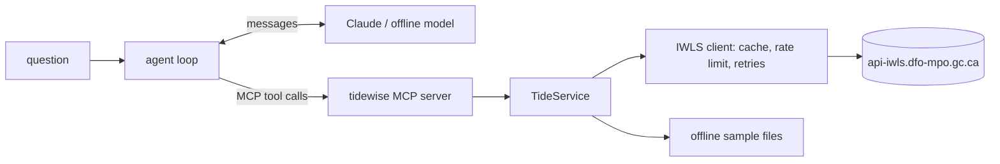

# Tidewise

An MCP server that gives AI assistants tools over real Canadian tide and water level data, plus a small agent CLI and an eval suite to check that the tools get used correctly.

I wanted to see how much it takes to make a public data API pleasant for a model to use: clear tool descriptions, strict inputs, error messages that say what to do next, and a way to measure whether a model picks the right tool.

[](https://github.com/andyhetianjun/tidewise/actions/workflows/ci.yml)

## What it does

Five MCP tools, backed by the Canadian Hydrographic Service's public water level API (IWLS):

| Tool | Use it for |
| --- | --- |
| `find_stations` | Find tide gauges by name, or the nearest ones to a latitude and longitude |
| `next_high_low_tide` | The next predicted highs and lows at a station, labelled high or low |
| `get_tide_predictions` | Predicted water level curve over a time range |
| `get_water_levels` | Observed (measured) water levels over a time range |
| `compare_observed_vs_predicted` | Mean, RMS and largest gap between measured and predicted |

Things I cared about:

- Typed inputs with docstrings that become the tool descriptions the model sees.
- Validation with helpful errors: bad coordinates, ranges over 7 days, unknown stations, stations that do not report a series, and a station that is listed but silent (Halifax had no observed readings in my sample).
- A date like `2026-11-26` means that whole day in the station's local time, so "tomorrow" works. Results come back in UTC and local time.
- On-disk cache (24 hours for predictions, 10 minutes for observed data) and a rate limit of one request per second, with retries on 429 and 5xx that respect `Retry-After`.

## Run it

You need [uv](https://docs.astral.sh/uv/).

```bash
git clone https://github.com/andyhetianjun/tidewise
cd tidewise
uv sync

# Everything below works offline, using the committed sample data
uv run pytest -q
uv run tidewise eval
uv run tidewise ask "When is high tide in Halifax tomorrow?" --offline --model fake -v
```

Output of that last command:

```
[tool] find_stations {'query': 'Halifax', 'limit': 3}
[tool] next_high_low_tide {'station': '00490', 'after': '2026-11-26', 'count': 6}
Tides at Halifax on 2026-11-26: low tide at 02:47 AST (0.353 m); high tide at 08:36 AST (1.977 m); low tide at 15:33 AST (-0.02 m); high tide at 21:25 AST (1.747 m).
```

Live data and a real model:

```bash
export ANTHROPIC_API_KEY=...        # only needed for the agent, not the server
uv run tidewise ask "When is high tide in Halifax tomorrow?" -v
```

The agent calls `claude-sonnet-5-5` with the Anthropic SDK. Without a key, `ask` falls back to the offline rule-based model and says so.

### Use the server from an MCP client

The server speaks MCP over stdio. Most clients take a config like this one (Claude Desktop uses `mcpServers` in `claude_desktop_config.json`; other clients are similar):

```json
{
  "mcpServers": {
    "tidewise": {
      "command": "uv",
      "args": ["run", "--directory", "/absolute/path/to/tidewise", "tidewise", "serve"]
    }
  }
}
```

Add `"env": { "TIDEWISE_OFFLINE": "1" }` to use the bundled sample instead of the live API.

With Docker (I wrote the Dockerfile but have not built the image on my own machine yet):

```bash
docker build -t tidewise .
docker run -i --rm -v tidewise-cache:/cache tidewise
```

and use `"command": "docker", "args": ["run", "-i", "--rm", "tidewise"]` in the client config.

## How it works



- `service.py` has the tool logic as plain methods. `server.py` wraps them as MCP tools and turns my own errors into tool errors the client can read.
- The data source is swappable. `iwls.py` talks to the API; `fixtures.py` reads the committed sample. Tests and the eval use the sample.
- The agent talks to the server through a real MCP client connected in-process, so it sees exactly the tool list and schemas that any other client would.
- High and low tide labels: the API returns tide events without saying which are highs, so the tool fetches a little before the requested time and compares each event with its neighbour.

## Evals

`src/tidewise/eval_cases.json` has 21 questions. Each one names the tool that should answer it, the arguments that must match (for example the station), and facts the final answer must contain, such as a time or a height. I worked those facts out from the sample data by hand. Two cases are deliberately awkward: a station that reports no observed data, and a question that needs no tool at all.

```bash
uv run tidewise eval        # offline, rule-based model
uv run tidewise eval -v     # show every case
```

Measured on my machine (offline sample, rule-based model):

```
cases: 21
tool selection: 21/21 (100%)
answer correct: 21/21 (100%)
both:           21/21 (100%)
```

**Read that score carefully.** The offline model is a keyword matcher I wrote, not a language model. It was built against these same questions, so 100% only shows that the tools, the loop, the answer checks and the sample data fit together. There is a test that a wrong model scores below 20%, so the checks can fail. I have not run the eval with Claude because I had no API key while building this. To measure a real model:

```bash
ANTHROPIC_API_KEY=... uv run tidewise eval --model anthropic -v
```

That run is the number that would mean something. Answer checks accept several spellings of a time or number (for example `08:36` or `8:36`), but a model may still phrase things in a way I did not allow for.

## Data and the offline sample

Data comes from Fisheries and Oceans Canada, Canadian Hydrographic Service, through the public [IWLS API](https://api-iwls.dfo-mpo.gc.ca). Please check their terms before heavy use.

`src/tidewise/data/` holds a 168 KB sample of real responses: the list of operating stations (135), and for Halifax, Vancouver, Saint John, Charlottetown and Tofino, predictions and high/low events for 2026-11-24 to 2026-11-29 plus observed levels up to 2026-11-25 12:00 UTC. Offline mode pretends it is that moment, so "tomorrow" is 2026-11-26. Refresh it with `uv run python scripts/fetch_samples.py`; the eval answers would then need checking again.

## Limits

- Time zones come from the station's province code, so a few stations near borders may show the wrong local zone.
- Predictions have no weather in them. In the sample, observed water at Vancouver was on average 0.52 m above prediction on 2026-11-24; the comparison tool reports that, but it cannot tell you why.
- Ranges are capped at 7 days and 200 points per call to keep results small enough for a model to read.
- Offline mode only knows five stations and five days. Outside that you get an error saying so.

## What I'd do next

- Run the eval against Claude and report the real score, and compare a few phrasings per question.
- Add buoy data (Environment Canada or NOAA NDBC) for wave height.
- Add the current speed series some stations have.
- Serve over streamable HTTP as well as stdio.
- Look up time zones from coordinates instead of provinces.

## Project layout

```
src/tidewise/
  server.py       MCP tool definitions
  service.py      tool logic
  stations.py     name and distance search
  iwls.py         live API client
  fixtures.py     offline sample reader
  agent.py        tool-calling loop, Anthropic model wrapper
  fake.py         scripted and rule-based offline models
  evaluation.py   scoring
  eval_cases.json the questions
tests/            pytest suite
scripts/          fetch_samples.py
```

MIT licensed.
