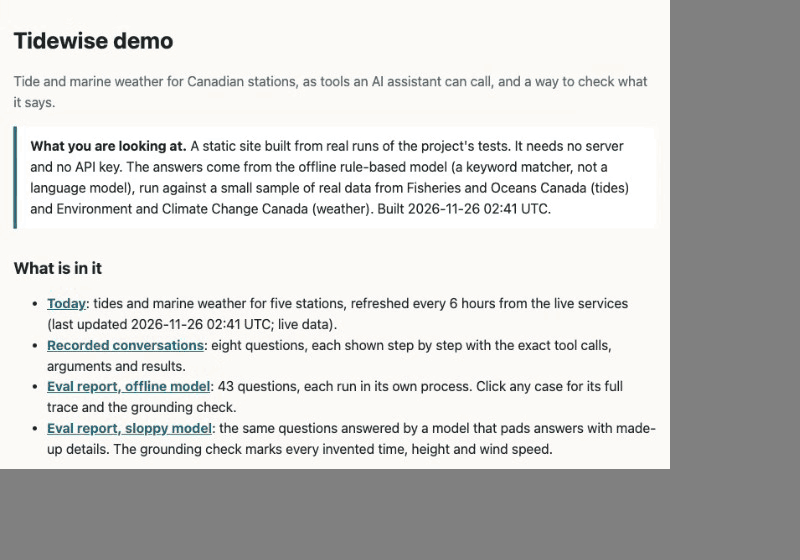
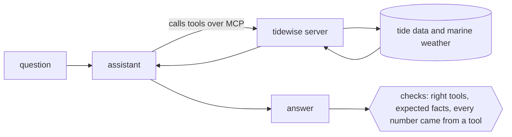
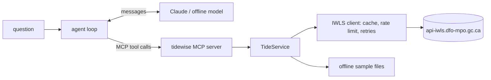

# Tidewise

I built a small server that lets an AI assistant look up real Canadian tide and water level data, plus a command line agent and a set of test questions that check its answers. I did it because my summer 2026 co-op at Fisheries and Oceans Canada had me working with ocean data, which made me curious about the tide data they publish. I also wanted to learn how to give an AI assistant real tools (using MCP, the Model Context Protocol, a standard way for an assistant to call outside programs) and how to check that it uses them correctly.

**Try it:** [andyhetianjun.github.io/tidewise](https://andyhetianjun.github.io/tidewise/). It has a Today page (tides and marine weather for five stations, rebuilt every 6 hours), the eval reports with a trace for every case, and example conversations step by step (from the offline model).

[](https://github.com/andyhetianjun/tidewise/actions/workflows/ci.yml)



## How Claude does

I ran all 43 questions with Claude Sonnet 5.5 as the assistant:

| Model | Right tools | Answer as expected | Grounded | Traps handled | All three |
| --- | --- | --- | --- | --- | --- |
| Claude Sonnet 5.5 (recorded) | 40/43 | 37/43 | 38/43 | 15/15 | 31/43 |
| Offline rule-based model | 42/43 | 43/43 | 43/43 | 15/15 | 42/43 |
| Deliberately sloppy model | 42/43 | 28/43 | 3/43 | 0/15 | 3/43 |

How this was recorded: there was no API key, so each question was run by a separate, fresh Claude Sonnet 5.5 session that played the assistant by typing shell commands into a recording harness ([RECORDING.md](RECORDING.md)). The harness runs the real tools on the bundled sample, logs every call, and saves the final answer. So these are real answers from the model, recorded once, not a live API call and not a repeated run. The model's thinking between calls is not captured. The recordings are in `recordings/claude-sonnet-5-5/` and you can step through each one on the [demo site](https://andyhetianjun.github.io/tidewise/recorded.html). To score them again: `uv run tidewise eval --from-recordings recordings/claude-sonnet-5-5`.

Claude handled all 15 questions with no answer correctly. It lost points on 12 of the 43. Several of those are my checks being strict about wording, not wrong answers; [Where Claude slipped](#where-claude-slipped) goes through each. The rule-based model scores higher because I wrote it against these questions, so the comparison says more about my checks than about which one is smarter. One run per question is a small sample.

## Install in one line

You need [uv](https://docs.astral.sh/uv/), a Python package tool. Nothing else to install, and no account or API key:

```bash
uvx --from git+https://github.com/andyhetianjun/tidewise tidewise ask "When is high tide in Halifax tomorrow?" --offline --model fake -v
```

To add the tools to an MCP client (an app that lets an assistant call tools), put this in its config:

```json
{
  "mcpServers": {
    "tidewise": {
      "command": "uvx",
      "args": ["--from", "git+https://github.com/andyhetianjun/tidewise", "tidewise", "serve"]
    }
  }
}
```

Add `"env": { "TIDEWISE_OFFLINE": "1" }` to use the bundled sample instead of the live service. I checked both commands from an empty folder against a local copy of the repo (a real MCP client listed the seven tools and called one). I have not tried any particular desktop MCP app.

## How it works



The server turns public tide and weather data into seven tools. The assistant picks tools, reads what they return and writes the answer. The checks then score it. More detail is under Design and Architecture below.

## Features

- [Weather alongside tides](docs/weather.md): marine forecasts and hourly weather from Environment Canada, and questions that need both.
- [Grounded answers](docs/grounded-answers.md): a check that every time, height and wind speed in an answer came from a tool, plus questions where the right answer is "I don't know".
- [Eval runner](docs/eval-runner.md): each eval case in its own process, in parallel, with timeouts, retries and a clickable HTML report.

## What it does

You can ask "When is high tide in Halifax tomorrow?" and the assistant picks the right tool, fetches the data and answers with times and heights. The data comes from the public water level service run by the Canadian Hydrographic Service (called IWLS). The server offers seven tools:

| Tool | Use it for |
| --- | --- |
| `find_stations` | Find tide gauges by name, or the nearest ones to a latitude and longitude |
| `next_high_low_tide` | The next predicted highs and lows at a station, labelled high or low |
| `get_tide_predictions` | Predicted water level curve over a time range |
| `get_water_levels` | Observed (measured) water levels over a time range |
| `compare_observed_vs_predicted` | Mean, RMS and largest gap between measured and predicted |
| `get_marine_forecast` | Marine weather text and warnings for the water at a station (Environment Canada) |
| `get_hourly_weather` | Hourly wind, temperature and rain chance near a station, about the next 24 hours |

## How to use it

You need [uv](https://docs.astral.sh/uv/), a Python package tool. Everything below works offline, using a small sample of real data saved in the repo.

```bash
git clone https://github.com/andyhetianjun/tidewise
cd tidewise
uv sync

uv run pytest -q
uv run tidewise eval
uv run tidewise ask "When is high tide in Halifax tomorrow?" --offline --model fake -v
```

The last command prints:

```
[tool] find_stations {'query': 'Halifax', 'limit': 3}
[tool] next_high_low_tide {'station': '00490', 'after': '2026-11-26', 'count': 6}
Tides at Halifax on 2026-11-26: low tide at 02:47 AST (0.353 m); high tide at 08:36 AST (1.977 m); low tide at 15:33 AST (-0.02 m); high tide at 21:25 AST (1.747 m).
```

To use live data and a real model, set an API key (only the agent needs one, not the server):

```bash
export ANTHROPIC_API_KEY=...
uv run tidewise ask "When is high tide in Halifax tomorrow?" -v
```

Without a key, `ask` falls back to a simple offline model and says so.

### Use a local copy from an MCP client

If you cloned the repo, point the client at the folder instead:

```json
{
  "mcpServers": {
    "tidewise": {
      "command": "uv",
      "args": ["run", "--directory", "/absolute/path/to/tidewise", "tidewise", "serve"]
    }
  }
}
```

Add `"env": { "TIDEWISE_OFFLINE": "1" }` to use the bundled sample instead of the live service.

There is also a Dockerfile (`docker build -t tidewise .`). I have not built it on my own machine; the GitHub Actions workflow builds it on every push.

## Design

- Tool inputs are typed and strict, and the docstrings become the descriptions the model reads. Errors say what to do next: bad coordinates, ranges over 7 days, unknown stations, stations that do not report a series, and a station that is listed but silent (Halifax had no observed readings in my sample).
- A date like `2026-11-26` means that whole day in the station's local time, so "tomorrow" works. Results come back in UTC and local time.
- Responses are cached on disk (24 hours for predictions, 10 minutes for observed data). Requests are limited to one per second, with retries on 429 and 5xx errors that respect `Retry-After`.
- The tool logic is plain Python methods, kept separate from the MCP wrapper, so the data source can be swapped between the live service and the saved sample.

More detail is in [docs/design.md](docs/design.md).

## Checking the answers

`src/tidewise/eval_cases.json` has 43 questions: 18 about tides, 5 about weather, 5 that need tides and weather together, and 15 traps where the right answer is to say it does not know. Each question names the tool that should answer it, the arguments that must match, and facts the answer must contain. I worked those facts out from the sample data by hand. Three checks run on every case: right tools, answer as expected, and [grounded](docs/grounded-answers.md) (nothing in the answer that no tool returned). Five traps are held out: I wrote them after the offline model was finished.

```bash
uv run tidewise eval                       # offline, rule-based model, in one process
uv run tidewise eval --model sloppy        # a careless stand-in, to see the checks catch it
uv run tidewise run-evals --out report     # one process per case, in parallel, HTML report
```

Measured on my machine (offline sample, rule-based model):

```
cases: 43
tool selection: 42/43 (98%)
answer correct: 43/43 (100%)
grounded:       43/43 (100%)
all three:      42/43 (98%)
trap cases handled (said so, invented nothing): 15/15
held-out cases, all three checks: 4/5
```

The sloppy stand-in calls the right tools but pads answers and never says it does not know: 42/43 tools, 28/43 answers that contain the expected facts, but only 3/43 grounded and 0/15 traps handled.

Claude's recorded run (table at the top) scores 31/43 on all three checks, 4/5 on the held-out questions. The offline model is a keyword matcher I wrote against most of these questions, so its scores show that the tools, the loop, the checks and the runner fit together, and that the checks can fail.

### Where Claude slipped

These are the 12 questions Claude did not pass fully, with what it actually did (the full traces are on the demo site).

Real mistakes, small ones:
- **Observed water level in Vancouver yesterday.** It reported the lowest reading as 0.79 m at the start of the day. The tool's lowest value was 0.71 m, the first reading of the next day, which the range included. It read the wrong end of the series.
- **Boat at Saint John.** It said to expect strong tidal currents in the Bay of Fundy. No tool said that; it came from general knowledge. The grounding check flagged the place name.
- **Halifax predictions on 2026-11-27, kayak at Halifax, paddling at Charlottetown.** It stated times no tool returned: "high near 09:30" and "low near 16:30" when the hourly points were on the hour, "slack high around 08:30" when the tool said 08:36, and a "best window to 15:30" it chose itself. They are reasonable guesses, and they are exactly what the grounding check is for.

Right answer, but my checks wanted something else:
- **Predicted levels in Vancouver.** It said the low was "about 0.02 m"; the tool said 0.015. Correct rounding, but the check looks for 0.01 or 0.015.
- **Tide table for Saint John.** It used the high and low tide tool instead of the hourly prediction tool. The four highs and lows it gave are right (8.55 m and 0.35 m), but the check wants the hourly table.
- **Temperature in Saint John.** It gave 1 to 3 C and left out the 4 C at noon from the range I asked for, so the "1 to 4" check failed.
- **Canoe at Tofino.** It said no, and gave the storm warning and the tide times, but not the exact words "not a good time".
- **Boat at Saint John.** Besides the Fundy line, it said "looks calm" and wrote "6:20 am" where the check looks for "looks good" and "06:20".
- **Marine warnings for Vancouver.** The grounding check flagged "12:00 UTC". That is the current time from the system prompt, which Claude used to point out that the forecast issue time looked later than now. It is a false alarm from my checker, and a sensible observation from Claude.
- **Waves in Halifax; tidal streams in Halifax Harbour.** Both answers correctly say it does not know. It looked at the marine forecast (waves) or a station (streams) first, and my tool check wants no tool call for these.

Counting only the first group as real mistakes, Claude made small errors on 5 of 43 questions. That reading is mine, so treat it as a judgement, not a measurement.

## Limits

- Time zones come from the station's province code, so a few stations near borders may show the wrong local zone.
- Tide predictions have no weather in them (the weather tools add forecasts, but only for about the next day). In the sample, observed water at Vancouver was on average 0.52 m above prediction on 2026-11-24; the comparison tool reports that, but it cannot say why.
- Ranges are capped at 7 days and 200 points per call, to keep results small enough for a model to read.
- Offline mode only knows five stations, five days of tides and about one day of weather. Outside that you get an error saying so.

## What I would do next

- Run each question several times and with a few phrasings, since one recorded run per question is a small sample. Relax the checks that were only strict about wording.
- Add buoy data for wave height (a trap question today).
- Add the current speed series some stations have.
- Serve over streamable HTTP as well as standard input and output.
- Look up time zones from coordinates instead of provinces.

## Architecture and tests



- The agent connects to the server through a real MCP client running in the same process, so it sees the same tool list and schemas any other client would.
- Tests: 132 pass (`uv run pytest -q`). Lint and format checks pass (`uv run ruff check .`, `uv run ruff format --check .`).
- CI (GitHub Actions) runs lint, format check, tests, the offline eval and a Docker build. A second workflow builds the demo site and publishes it to GitHub Pages, on every push to main and every 6 hours (`uv run tidewise site --out site --live`). The Today page fetches live data while the site is built, shows when it was last updated, and falls back to the bundled sample for any part that does not answer; nothing fetched is committed.
- Tide data comes from Fisheries and Oceans Canada through the public [IWLS API](https://api-iwls.dfo-mpo.gc.ca). Weather comes from Environment and Climate Change Canada through the [MSC GeoMet API](https://api.weather.gc.ca), under the Open Government Licence - Canada. Please check their terms before heavy use.

MIT licensed.
