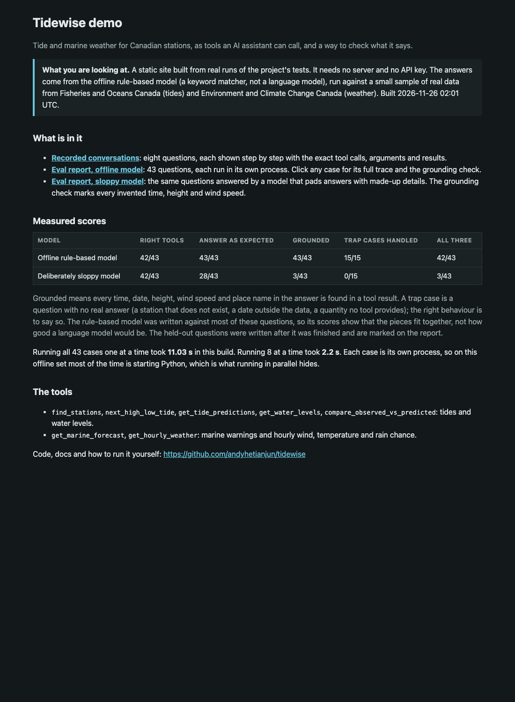
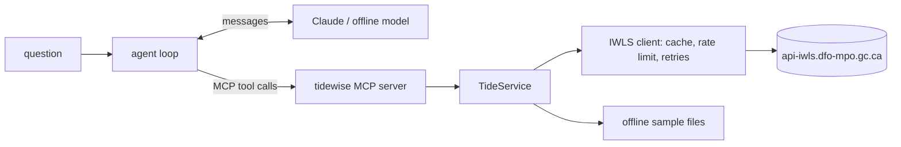

# Tidewise

**Try it:** [andyhetianjun.github.io/tidewise](https://andyhetianjun.github.io/tidewise/) (a static demo: eval report with a trace for every case, and recorded example conversations)



I built a small server that lets an AI assistant look up real Canadian tide and water level data, plus a command line agent and a set of test questions that check its answers. I did it because my summer 2026 co-op at Fisheries and Oceans Canada had me working with ocean data, which made me curious about the tide data they publish. I also wanted to learn how to give an AI assistant real tools (using MCP, the Model Context Protocol, a standard way for an assistant to call outside programs) and how to check that it uses them correctly.

[](https://github.com/andyhetianjun/tidewise/actions/workflows/ci.yml)

## Features

- [Weather alongside tides](docs/weather.md): marine forecasts and hourly weather from Environment Canada, and questions that need both.
- [Grounded answers](docs/grounded-answers.md): a check that every time, height and wind speed in an answer came from a tool, plus questions where the right answer is "I don't know".
- [Eval runner](docs/eval-runner.md): each eval case in its own process, in parallel, with timeouts, retries and a clickable HTML report.

## What it does

You can ask "When is high tide in Halifax tomorrow?" and the assistant picks the right tool, fetches the data and answers with times and heights. The data comes from the public water level service run by the Canadian Hydrographic Service (called IWLS). The server offers seven tools:

| Tool | Use it for |
| --- | --- |
| `find_stations` | Find tide gauges by name, or the nearest ones to a latitude and longitude |
| `next_high_low_tide` | The next predicted highs and lows at a station, labelled high or low |
| `get_tide_predictions` | Predicted water level curve over a time range |
| `get_water_levels` | Observed (measured) water levels over a time range |
| `compare_observed_vs_predicted` | Mean, RMS and largest gap between measured and predicted |
| `get_marine_forecast` | Marine weather text and warnings for the water at a station (Environment Canada) |
| `get_hourly_weather` | Hourly wind, temperature and rain chance near a station, about the next 24 hours |

## How to use it

You need [uv](https://docs.astral.sh/uv/), a Python package tool. Everything below works offline, using a small sample of real data saved in the repo.

```bash
git clone https://github.com/andyhetianjun/tidewise
cd tidewise
uv sync

uv run pytest -q
uv run tidewise eval
uv run tidewise ask "When is high tide in Halifax tomorrow?" --offline --model fake -v
```

The last command prints:

```
[tool] find_stations {'query': 'Halifax', 'limit': 3}
[tool] next_high_low_tide {'station': '00490', 'after': '2026-11-26', 'count': 6}
Tides at Halifax on 2026-11-26: low tide at 02:47 AST (0.353 m); high tide at 08:36 AST (1.977 m); low tide at 15:33 AST (-0.02 m); high tide at 21:25 AST (1.747 m).
```

To use live data and a real model, set an API key (only the agent needs one, not the server):

```bash
export ANTHROPIC_API_KEY=...
uv run tidewise ask "When is high tide in Halifax tomorrow?" -v
```

Without a key, `ask` falls back to a simple offline model and says so.

### Use the server from an MCP client

The server talks MCP over standard input and output. Most MCP clients take a config like this one:

```json
{
  "mcpServers": {
    "tidewise": {
      "command": "uv",
      "args": ["run", "--directory", "/absolute/path/to/tidewise", "tidewise", "serve"]
    }
  }
}
```

Add `"env": { "TIDEWISE_OFFLINE": "1" }` to use the bundled sample instead of the live service.

There is also a Dockerfile (`docker build -t tidewise .`). I have not built it on my own machine; the GitHub Actions workflow builds it on every push.

## Design

- Tool inputs are typed and strict, and the docstrings become the descriptions the model reads. Errors say what to do next: bad coordinates, ranges over 7 days, unknown stations, stations that do not report a series, and a station that is listed but silent (Halifax had no observed readings in my sample).
- A date like `2026-11-26` means that whole day in the station's local time, so "tomorrow" works. Results come back in UTC and local time.
- Responses are cached on disk (24 hours for predictions, 10 minutes for observed data). Requests are limited to one per second, with retries on 429 and 5xx errors that respect `Retry-After`.
- The tool logic is plain Python methods, kept separate from the MCP wrapper, so the data source can be swapped between the live service and the saved sample.

More detail is in [docs/design.md](docs/design.md).

## Checking the answers

`src/tidewise/eval_cases.json` has 43 questions: 18 about tides, 5 about weather, 5 that need tides and weather together, and 15 traps where the right answer is to say it does not know. Each question names the tool that should answer it, the arguments that must match, and facts the answer must contain. I worked those facts out from the sample data by hand. Three checks run on every case: right tools, answer as expected, and [grounded](docs/grounded-answers.md) (nothing in the answer that no tool returned). Five traps are held out: I wrote them after the offline model was finished.

```bash
uv run tidewise eval                       # offline, rule-based model, in one process
uv run tidewise eval --model sloppy        # a careless stand-in, to see the checks catch it
uv run tidewise run-evals --out report     # one process per case, in parallel, HTML report
```

Measured on my machine (offline sample, rule-based model):

```
cases: 43
tool selection: 42/43 (98%)
answer correct: 43/43 (100%)
grounded:       43/43 (100%)
all three:      42/43 (98%)
trap cases handled (said so, invented nothing): 15/15
held-out cases, all three checks: 4/5
```

The sloppy stand-in calls the right tools but pads answers and never says it does not know: 42/43 tools, 28/43 answers that contain the expected facts, but only 3/43 grounded and 0/15 traps handled.

Read these scores carefully. The offline model is a keyword matcher I wrote, not a language model, and I built it against most of these questions. So the scores show that the tools, the loop, the checks and the runner fit together, and that the checks can fail. They say nothing about Claude. I have not run the eval with Claude because I had no API key while building this, so that part is untested. To measure a real model:

```bash
ANTHROPIC_API_KEY=... uv run tidewise run-evals --model anthropic
```

## Limits

- Time zones come from the station's province code, so a few stations near borders may show the wrong local zone.
- Tide predictions have no weather in them (the weather tools add forecasts, but only for about the next day). In the sample, observed water at Vancouver was on average 0.52 m above prediction on 2026-11-24; the comparison tool reports that, but it cannot say why.
- Ranges are capped at 7 days and 200 points per call, to keep results small enough for a model to read.
- Offline mode only knows five stations, five days of tides and about one day of weather. Outside that you get an error saying so.

## What I would do next

- Run the eval against Claude and report the real score, with a few phrasings per question.
- Add buoy data for wave height (a trap question today).
- Add the current speed series some stations have.
- Serve over streamable HTTP as well as standard input and output.
- Look up time zones from coordinates instead of provinces.

## Architecture and tests



- The agent connects to the server through a real MCP client running in the same process, so it sees the same tool list and schemas any other client would.
- Tests: 122 pass (`uv run pytest -q`). Lint and format checks pass (`uv run ruff check .`, `uv run ruff format --check .`).
- CI (GitHub Actions) runs lint, format check, tests, the offline eval and a Docker build. A second workflow builds the demo site and publishes it to GitHub Pages (`uv run tidewise site --out site`).
- Tide data comes from Fisheries and Oceans Canada through the public [IWLS API](https://api-iwls.dfo-mpo.gc.ca). Weather comes from Environment and Climate Change Canada through the [MSC GeoMet API](https://api.weather.gc.ca), under the Open Government Licence - Canada. Please check their terms before heavy use.

MIT licensed.
