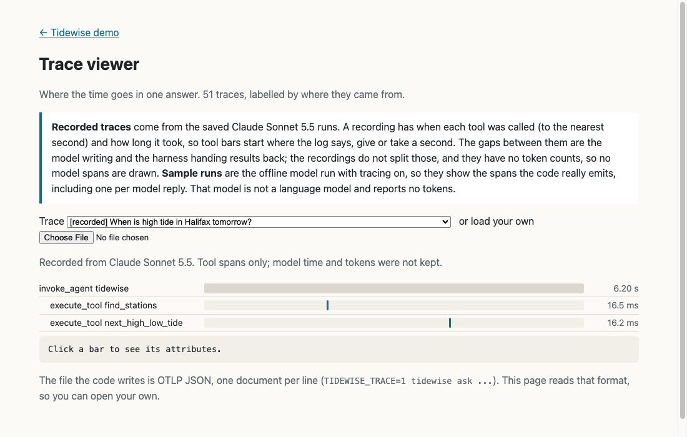

# Tracing: where the time goes in each answer

## Why I added this

I wanted to see where time and tokens go in each answer. The eval tells me whether an answer was right, but not why one question took 3 seconds and another took 9, or which step did the waiting. Tracing records every step of one answer (each model reply and each tool call) as a small timed record called a span, and lines the spans up so you can read them as a waterfall.

I used OpenTelemetry, the standard way to record traces, so the output opens in tools I did not have to write. Its GenAI conventions give agent steps, model calls and tool calls fixed names and attribute names (`gen_ai.operation.name`, `gen_ai.tool.name`, `gen_ai.usage.input_tokens` and so on).



You can look at real ones now: the [trace viewer](https://andyhetianjun.github.io/tidewise/traces.html) on the demo site. Traces labelled "recorded" come from the saved Claude Sonnet 5.5 runs; "sample run" ones come from the offline model run with tracing on.

## Try it

Nothing external is needed. Tracing is off unless you ask:

```bash
uv run tidewise --trace ask "When is high tide in Halifax tomorrow?" --offline --model fake
```

That writes `traces/tidewise.otlp.jsonl`: one OTLP JSON document per line (the format the OpenTelemetry collector's file exporter uses). Open the file in the trace viewer page ("load your own") to see it as a waterfall. `TIDEWISE_TRACE=1` does the same as `--trace`, and `TIDEWISE_TRACE_FILE=somewhere.jsonl` changes the path. Under `tidewise run-evals` each case runs in its own process, so set `TIDEWISE_TRACE=1` in the environment instead of using the flag.

To send traces to Jaeger (or any OTLP endpoint) instead, set the standard variable:

```bash
docker compose -f docker-compose.tracing.yml up -d
OTEL_EXPORTER_OTLP_ENDPOINT=http://localhost:4318 uv run tidewise --trace ask "..." --offline --model fake
# then open http://localhost:16686 and pick the service "tidewise"
```

I could not run Docker on my Mac, so the compose file is untested against a real Jaeger. CI checks that the file parses (`docker compose config`) and a unit test checks the endpoint setting picks the OTLP HTTP exporter, but nobody has seen a trace arrive in Jaeger yet. The other `OTEL_EXPORTER_OTLP_*` variables (headers, timeout) are read by the OpenTelemetry exporter itself. If the endpoint is set, the file is not written unless you also set `TIDEWISE_TRACE_FILE`.

## What gets recorded

One answer is one trace:

```
invoke_agent tidewise
  chat claude-sonnet-5-5            one per model reply
  execute_tool find_stations        one per tool call
  chat claude-sonnet-5-5
  execute_tool next_high_low_tide
  chat claude-sonnet-5-5            the final answer
```

| Span | Attributes |
| --- | --- |
| `invoke_agent tidewise` | `gen_ai.operation.name`, `gen_ai.provider.name`, `gen_ai.agent.name`, `gen_ai.request.model`, `gen_ai.response.finish_reasons`, summed `gen_ai.usage.input_tokens` / `output_tokens` when known, `tidewise.steps`, `tidewise.tool_calls` |
| `chat <model>` (client span) | `gen_ai.operation.name`, `gen_ai.provider.name`, `gen_ai.request.model`, `gen_ai.response.model`, `gen_ai.response.finish_reasons`, `gen_ai.usage.input_tokens`, `gen_ai.usage.output_tokens` |
| `execute_tool <name>` | `gen_ai.operation.name`, `gen_ai.tool.name`, `gen_ai.tool.call.id`, `gen_ai.tool.type` |

Errors: a tool that returns an error, or raises, gets status ERROR and `error.type` (`tool_error` or the exception class); an exception from the model call is recorded on the `chat` span and the agent span, then raised again; hitting the step limit marks the agent span as an error with `error.type = max_steps`.

Things worth knowing:

- Token counts are only there when the model reports them. The Anthropic client does; the offline models do not, and I do not make numbers up for them.
- There is no separate retrieval span because Tidewise has no search step. Its data lookups are the tool calls, so they are `execute_tool` spans.
- Question text, answers, tool arguments and tool results are not recorded unless `TIDEWISE_TRACE_CONTENT=1`, because they can hold anything someone typed.
- The attribute names come from the GenAI conventions as I read them when I wrote this. Those conventions are still changing, so a newer version of the OpenTelemetry packages may rename some.

## What the recorded traces can and cannot show

The saved Claude recordings come from a harness where a Claude session typed shell commands (see [RECORDING.md](../RECORDING.md)). They keep the time each tool was called (to the second) and how long it took. They do not keep model timings or token counts. So a recorded trace in the viewer has the whole run as one bar and a small bar per tool call. The tool calls take about 15 ms each while the run takes several seconds, which says that almost all of the time in those runs was the model and the harness, not the tools. It cannot say more than that. Real model spans and tokens appear when you run with an API key and tracing on.

## Overhead

Measured with `uv run python scripts/bench_tracing.py 30` on my laptop (Apple silicon, Python 3.12): the 43 eval questions answered by the offline model, once with tracing off and once on (file exporter, flushed at the end), 30 rounds alternating, median of each.

| | per run of 43 questions | per question |
| --- | --- | --- |
| tracing off | 64 ms | 1.5 ms |
| tracing on | 75 to 77 ms | 1.7 to 1.8 ms |
| difference | 11 to 13 ms (two separate 30-round runs: 19% and 20%) | about 0.3 ms |

Each run is 240 spans and about 155 KB of file, so tracing cost about 0.05 ms per span. The percentage looks big because the offline model answers in about a millisecond; this is close to the worst case. The recorded Claude runs took several seconds per question, so 0.3 ms would be a tiny share of that, but I have not measured tracing against a live model, so treat that as an estimate. With tracing off, the code uses OpenTelemetry's no-op tracer; I did not separately measure that, and the "off" column above includes it.

## Tests

`tests/test_tracing.py` checks the span tree (parents, one trace id), names, the `gen_ai.*` attributes, token counts, errors and the step limit, that content is not recorded by default, that the file is valid OTLP JSON with correctly sized hex ids, that `OTEL_EXPORTER_OTLP_ENDPOINT` selects the HTTP exporter, that the compose file parses, and how a recording turns into spans. `tests/test_site.py` checks that the site builds `traces.json` with both kinds of trace.

```bash
uv run pytest -q tests/test_tracing.py
```
